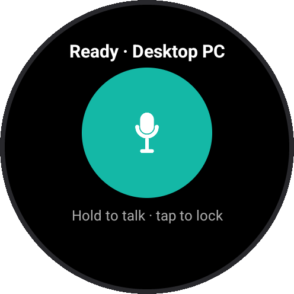
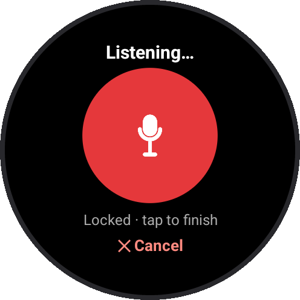
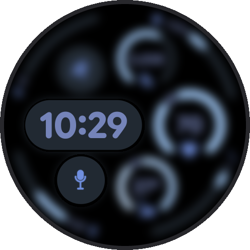

# Wristle

**Dictate into your PC from your wrist.** Wristle turns a Wear OS watch into a
wireless push-to-talk microphone for the local dictation app you already use,
such as [Hex](https://github.com/anomalyco/hex) or [Handy](https://github.com/cjpais/Handy).
Hold the button on your watch (or tap it on your watch face), talk, and the text
appears wherever your cursor is.

<p align="center">
  
  
  
</p>
<p align="center"><sub>Ready · Listening (tap-to-lock) · One-tap complication on the watch face</sub></p>

Your dictation app still does all the speech recognition, locally, on your PC.
Wristle only moves raw audio from the watch to the PC over your home Wi-Fi.

```
Wear OS watch ──Wi-Fi (LAN only)──▶ Wristle listener ──virtual audio cable──▶ dictation app ──▶ text at cursor
 mic + button                      holds the app's shortcut
```

## Features

- Hold to talk, or tap once to lock recording on and tap again to send
- **Wristle Dictate**: a watch face complication that starts listening in one tap
- Finds your PC automatically on the local network; approve each new watch once
- Audio is buffered while the watch reconnects, so the first words aren't lost
- Can start silently at login on Windows
- No cloud, no account, nothing saved unless you ask

## Compatibility

| | Status |
| --- | --- |
| **Watches** | **Tested: Pixel Watch 4.** Should work on any Wear OS 3+ watch with a microphone and Wi-Fi (Galaxy Watch 4 and newer, other Pixel Watches, OnePlus Watch 2, TicWatch Pro 5, …), but these are **not tested** yet. |
| **Dictation apps** | Any app that (1) lets you choose the microphone and (2) records while a shortcut is held. **Tested: Hex on Windows.** Expected to work: Handy. |
| **Desktop** | **Tested: Windows 11.** macOS and Linux (X11) are supported in the code but **not tested** yet. Python 3.10+. |

Only the setups marked **tested** have been tried. If you run Wristle on another
watch, dictation app or OS, please [open an issue](https://github.com/unknownprocess/wristle/issues)
saying what worked and what didn't (watch model, Wear OS version, app), or send
a PR updating this table.

---

## Setup

### 1. Desktop

**Install a virtual audio cable**

- Windows: [VB-Audio Virtual Cable](https://vb-audio.com/Cable/) (free). Install it, then reboot if the cable doesn't show up.
- macOS: [BlackHole](https://github.com/ExistentialAudio/BlackHole), e.g. `brew install blackhole-2ch`.
- Linux: `pactl load-module module-null-sink sink_name=wristle` and
  `pactl load-module module-remap-source master=wristle.monitor source_name=wristle_mic`.
  The listener plays into the `wristle` sink by default (set `PULSE_SINK` to use another),
  and your dictation app records from `wristle_mic`.

Afterwards, check that your normal speakers and mic are still the system
defaults. Windows sometimes switches to the new cable.

**Configure your dictation app**

| App | Microphone | Shortcut mode | Listener option |
| --- | --- | --- | --- |
| Hex (Windows) | `CABLE Output (VB-Audio Virtual Cable)` | Hold (default `Ctrl+Space`) | none needed |
| Hex (macOS) | `BlackHole 2ch` | Hold Option (default) | none needed |
| Handy | the cable | push-to-talk | `--hotkey <your Handy shortcut>` |
| Other | the cable | hold / push-to-talk | `--hotkey <shortcut>` |

Shortcut format: `ctrl+space`, `alt`, `alt_r`, `ctrl+shift+space`, `f13` and so on.

**Run the listener**

- Windows: double-click `desktop\start.bat`. The first run installs the Python
  packages. When Windows Firewall asks, allow **Private networks**.
- macOS / Linux: `desktop/start.sh` (on macOS, give your terminal app
  Accessibility permission so it can press the shortcut).

Pass options after the script name, e.g. `start.bat --hotkey ctrl+shift+space`.

Quick checks:

```sh
python wristle.py --list-devices   # the cable should be listed
python wristle.py --test-hotkey    # your app's recording indicator should appear for 4 s
```

### 2. Watch

Download `wristle-x.y.z.apk` from [Releases](https://github.com/unknownprocess/wristle/releases).
Wear OS can't install APKs by tapping them, so use ADB over Wi-Fi once:

1. On the watch: *Settings → System → About → Versions*, tap **Build number** 7 times.
2. *Settings → Developer options*: turn on **ADB debugging** and **Wireless debugging**.
3. Install ADB on the PC: `winget install Google.PlatformTools` (Windows) or
   `brew install android-platform-tools` (macOS).
4. In *Wireless debugging*, tap **Pair new device** and keep that screen open:
   ```sh
   adb pair <ip>:<pairing port>        # enter the 6-digit code
   adb connect <ip>:<port>             # the port on the main Wireless debugging screen
   adb -s <ip>:<port> install -r wristle-0.1.0.apk   # -r also updates an existing install
   ```
5. Turn Wireless debugging off again. It drains the battery.

On a phone instead of a PC, apps like *Bugjaeger* can install the APK the same way.

### 3. First use

1. Start the listener on the PC, then open **Wristle** on the watch and allow the microphone.
2. The watch shows **Approve on PC · Pairing code 1234**. Check that the PC
   shows the same code, then type `y` + Enter in the listener window.
3. Click into any text box on the PC. On the watch, **hold** the button, talk,
   and release. Or **tap** to lock, and tap again to send. **✕ Cancel** discards.

If discovery fails, tap the status text at the top of the watch screen and
enter the PC's IP address.

### One tap from the watch face

Long-press your watch face → **Customize** → complications → choose a slot →
**Wristle**. Tapping it opens *Wristle Dictate*, which is already listening.
Tap once to send and it returns to the watch face. Some faces only allow
their own complications. If Wristle isn't listed, try another face, or use the
*Wristle Dictate* app icon.

### Start automatically (Windows)

Run `desktop\install_autostart.bat`. It starts the listener now, with no
window, and at every login. Options go after it, as with `start.bat`.
`stop.bat` stops it and `uninstall_autostart.bat` removes it. The log is at
`%APPDATA%\wristle\listener.log`.

Pairing a *new* watch needs the window version: run `stop.bat`, then
`start.bat`, approve, and close it.

> **Heads-up:** while your dictation app's microphone is set to the cable, it
> won't hear your laptop mic. On Windows you can feed both: *Sound settings →
> your mic → Properties → Listen → "Listen to this device"* with playback
> through *CABLE Input*.

---

## Listener options

| Option | Default | |
| --- | --- | --- |
| `--hotkey` | `ctrl+space` (Win/Linux), `alt` (macOS) | Shortcut to hold while you talk |
| `--device` | `CABLE Input` / `BlackHole` | Output device for the cable (name fragment or number) |
| `--gain` | `1.0` | Make watch audio louder or quieter |
| `--start-delay` | `0.15` | Silence before speech, if the first word gets clipped |
| `--tail` | `0.35` | Keep holding after speech ends, if the last word gets cut |
| `--name` | computer name | Name the watch shows for this PC (changing it means pairing again) |
| `--save-wav DIR` | off | Save each dictation for debugging |
| `--background` / `--stop` | | Run without a window / stop a running listener |
| `--list-devices`, `--test-hotkey` | | Diagnostics |

## Troubleshooting

| Watch says | Try |
| --- | --- |
| Waiting for Wi-Fi… | The watch must join the same Wi-Fi as the PC. |
| Can't reach PC / Looking for PC… | Is the listener running? Allow it through the firewall (network set to *Private*). Guest networks and "AP isolation" block device-to-device traffic. Enter the PC's IP manually. |
| Sent ✓ but no text | Check the app's microphone is the cable and it's in hold / push-to-talk mode. Run `--test-hotkey`; use `--save-wav rec` to check the audio. |
| First or last word missing | `--start-delay 0.3` / `--tail 0.6` |
| Denied on PC | You answered `n` on the PC. Reopen Wristle on the watch to ask again. |
| Approve on PC every time | The PC lost its pairing file, or the watch app was reinstalled. Approve it again. |

**Windows firewall fix** (admin PowerShell), if you dismissed the prompt:

```powershell
Get-NetFirewallRule -Direction Inbound -Action Block | Where-Object DisplayName -like "*python*" | Remove-NetFirewallRule
New-NetFirewallRule -DisplayName "Wristle TCP" -Direction Inbound -Protocol TCP -LocalPort 47820 -Action Allow -Profile Private
New-NetFirewallRule -DisplayName "Wristle UDP" -Direction Inbound -Protocol UDP -LocalPort 47821 -Action Allow -Profile Private
```

## Privacy and security

- Audio goes only over your local network, never to the internet.
- Audio is **not encrypted** on the network. Use Wristle on networks you trust.
- Only watches you approve on the PC (4-digit code) can start dictation. On
  approval the PC gives the watch a random key; after that the watch proves it
  has the key on every connection (HMAC challenge-response), so a device that
  copies the watch's ID can't connect. The key is sent once, at pairing, so
  pair on a network you trust.
- Approved watches and their keys are in `paired_watches.json` in the settings folder
  (`%APPDATA%\wristle`, `~/Library/Application Support/wristle` or
  `~/.config/wristle`). Keep it private. Delete the file to unpair everything.
- What Wristle doesn't protect against: someone on your network who can intercept
  and alter traffic as it passes (an active man-in-the-middle) can listen to and
  change a session that is already open.
- The listener presses only the one shortcut you configure, and only while
  a paired watch is sending audio.
- Nothing is saved unless you pass `--save-wav`.

## How it works

- **Discovery:** the watch broadcasts `WRISTLE?` on UDP 47821, and the
  listener replies with its TCP port and hostname.
- **Pairing:** the watch says hello with its ID. A new watch gets a random
  4-digit code to compare and waits for you to approve it on the PC, which then
  sends it a 256-bit key. A paired watch gets a random nonce and must answer
  with `HMAC-SHA256(key, "wristle-auth|<nonce>|<id>")`.
- **Stream:** length-prefixed frames over TCP 47820 (hello, auth, start, 20 ms
  chunks of 16 kHz mono 16-bit PCM, end or cancel, pings, status).
- **Desktop:** the audio is resampled to the cable's rate and played into it
  while the shortcut is held.
- **Watch app:** plain Java with no AndroidX. The complication speaks the Wear
  OS complication binder protocol directly.

`desktop/fake_watch.py` streams a WAV file as if it were a watch. It's handy
for working on the desktop side without a watch.

## Building the watch app

`watch/build.sh` builds the APK without Gradle, on Linux or WSL:

```sh
sudo apt install default-jdk aapt apksigner zipalign dalvik-exchange android-sdk-platform-23
watch/build.sh          # → watch/build/wristle-<version>.apk
```

The first build creates a signing key in `~/.wristle/`. **Back it up and never
commit it.** Updates only install over an existing app if they're signed with
the same key. You can also point `KEYSTORE` and `KEYSTORE_PASS` at your own key.

**Releases via GitHub Actions (optional):** add the repository secrets `KEYSTORE_BASE64`
(your keystore, base64-encoded) and `KEYSTORE_PASS`, push a tag such as `v0.2.0`,
then run *Actions → Release → Run workflow* on that tag. It builds and signs the
APK, zips the desktop listener, and attaches both to a GitHub Release.

## Credits

- [Hex](https://github.com/anomalyco/hex) and [Handy](https://github.com/cjpais/Handy),
  the local dictation apps that inspired this. Wristle isn't affiliated with either.
- The complication provider follows the protocol in Google's open-source
  [AndroidX Wear watch face libraries](https://github.com/androidx/androidx/tree/androidx-main/wear/watchface).

## License

[MIT](LICENSE)
